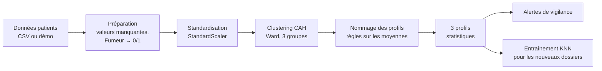

# 🏥 Plateforme Nationale de Segmentation et Sécurisation du Parcours Patients

Application web (Streamlit) d'**aide à l'analyse et à la décision** pour les professionnels de santé.
Elle utilise le **Machine Learning non supervisé** pour regrouper automatiquement les patients en
**profils statistiques** homogènes, puis aide le médecin à repérer les dossiers qui demandent le plus
d'attention.

> ⚠️ **Outil d'aide, pas un outil de diagnostic.** Les profils et les alertes sont des suggestions
> statistiques. Toute décision clinique doit être prise et validée par un professionnel de santé.

---

## 📌 Sommaire
[Lien vers l'application https://segmentation-patients-donnees-sante.streamlit.app/](#-Lien vers l'application https://segmentation-patients-donnees-sante.streamlit.app/-)
1. [À quoi sert l'application ?](#-à-quoi-sert-lapplication-)
2. [Les rubriques de l'application](#-les-rubriques-de-lapplication)
3. [Les données](#-les-données)
4. [Le Machine Learning expliqué simplement](#-le-machine-learning-expliqué-simplement)
5. [Les trois profils de patients](#-les-trois-profils-de-patients)
6. [Orientation d'un nouveau patient (KNN)](#-orientation-dun-nouveau-patient-knn)
7. [Les alertes (règles de vigilance)](#-les-alertes-règles-de-vigilance)
8. [Comment le médecin l'utilise](#-comment-le-médecin-lutilise)
9. [Limites et précautions](#-limites-et-précautions)
10. [Installation et lancement](#-installation-et-lancement)
11. [Structure du code](#-structure-du-code)
12. [Auteur](#-auteur)

---

## 🎯 À quoi sert l'application ?

Dans un hôpital ou un système de santé, les dossiers patients sont nombreux et très différents.
Il est difficile de savoir **par où commencer** et **quels patients suivre en priorité**.

L'application répond à trois questions :

| Question du médecin | Réponse de l'application |
|---|---|
| *Quels types de patients ai-je dans ma base ?* | **Segmentation** automatique en 3 profils |
| *Dans quel groupe se place un nouveau patient ?* | **Orientation** par l'algorithme KNN |
| *Quels dossiers demandent ma vigilance en premier ?* | **Registre d'alertes** classé par niveau |

---

## 🧭 Les rubriques de l'application

| Rubrique | Contenu |
|---|---|
| **Accueil & Galerie Médicale** | Indicateurs clés, présentation des 3 profils, galerie photo défilante |
| **Tableau de Bord Analytics** | Cartes d'indicateurs, graphiques (anneau, barres, histogramme, radar, nuage de points), tableau filtrable par profil et **téléchargement CSV de chaque profil** |
| **Orientation Patient (KNN)** | Formulaire : on saisit un nouveau dossier et l'application suggère son profil |
| **Registre des Alertes** | Liste des patients triée par niveau d'alerte (Rouge, Orange, Jaune, Vert), recherche et export CSV |
| **👤 Mon profil** | Présentation du développeur de la plateforme |

---

## 📂 Les données

### Colonnes utilisées

| Colonne | Type | Rôle |
|---|---|---|
| `Patient_ID` | texte | Identifiant du dossier |
| `Age` | nombre | Âge du patient |
| `Sexe` | texte | Femme / Homme |
| `IMC` | nombre | Indice de masse corporelle |
| `Fumeur` | Oui / Non | Tabagisme |
| `Hospitalisations` | nombre entier | Nombre d'hospitalisations |
| `Region` | texte | Région du patient |

Si une colonne manque dans le fichier importé, l'application la crée avec une valeur par défaut
au lieu de s'arrêter. Les valeurs vides sont remplacées par la médiane (colonnes numériques).

### D'où viennent les données ?

1. **Un fichier `patients.csv`** placé à côté de l'application (chargé automatiquement), ou
2. **Un import CSV** depuis la barre latérale (séparateurs `,` `;` tabulation ou `|` reconnus), ou
3. **Des données fictives de démonstration** (300 patients générés aléatoirement) si aucun fichier n'est fourni.

> Les données de démonstration sont **aléatoires** : les profils obtenus servent à illustrer le
> fonctionnement, pas à tirer des conclusions médicales.

---

## 🤖 Le Machine Learning expliqué simplement

### Pourquoi un apprentissage **non supervisé** ?

Dans la base, personne n'a écrit à l'avance « ce patient est du type A, celui-ci du type B ».
Il n'existe donc **pas d'étiquette** à prédire. On demande à l'algorithme de **découvrir lui-même**
les groupes naturels : des patients qui se ressemblent sont rassemblés, des patients très
différents sont séparés. C'est le principe du **clustering**.

### L'algorithme : la Classification Ascendante Hiérarchique (CAH)

L'application utilise `AgglomerativeClustering` de scikit-learn avec la méthode de **Ward**.

**Idée :** au départ, chaque patient est seul dans son groupe. L'algorithme fusionne ensuite,
étape après étape, les deux groupes les plus proches, jusqu'à obtenir **3 groupes**. La méthode de
Ward choisit à chaque fois la fusion qui rend les groupes le plus homogènes possible.

### Les étapes du traitement



1. **Préparation** : nettoyage des valeurs manquantes, limites raisonnables (âge 0–120, IMC 0–100),
   transformation de `Fumeur` en 0 / 1.
2. **Choix des variables** : l'algorithme se base sur **4 caractéristiques** :
   `Age`, `IMC`, `Fumeur_binaire`, `Hospitalisations`.
3. **Standardisation** (`StandardScaler`) : on met toutes les variables à la même échelle.
   Sans cela, l'âge (de 18 à 90) écraserait le tabagisme (0 ou 1) dans le calcul des distances.
4. **Clustering** : la CAH regroupe les patients en 3 clusters.
5. **Nommage des clusters** : un cluster est un simple numéro (0, 1, 2). L'application lui donne
   un nom lisible en comparant les moyennes de chaque groupe (voir section suivante).

### Pourquoi 3 profils ?

Trois groupes sont assez simples à lire et à utiliser en consultation, tout en séparant les situations
cliniques les plus marquantes : suivi courant, patients âgés très hospitalisés, patients à risque
métabolique et tabagique.

---

## 👥 Les trois profils de patients

Les noms sont attribués automatiquement, selon les moyennes de chaque groupe :

| Profil | Comment il est repéré | Pistes de lecture pour le médecin |
|---|---|---|
| **Patients seniors très hospitalisés** | Groupe dont l'**âge moyen** et le **nombre moyen d'hospitalisations** sont les plus élevés | Revoir le suivi lié à l'âge et l'historique des hospitalisations |
| **Patients fumeurs obèses** | Parmi les deux autres groupes, celui avec l'**IMC moyen** et le **taux de fumeurs** les plus élevés | Évaluer l'accompagnement au sevrage et les facteurs liés à l'IMC |
| **Adultes en suivi de routine, risque modéré** | Le groupe restant | Poursuivre le suivi habituel |

> S'il y a moins de 3 patients, aucun clustering n'est possible : tous sont placés dans le profil
> « Adultes en suivi de routine ».

Les patients de chaque profil peuvent être **affichés et téléchargés en CSV** depuis le Tableau de
Bord Analytics (par exemple `patients_seniors_tres_hospitalises.csv`).

---

## 🔎 Orientation d'un nouveau patient (KNN)

Quand un nouveau dossier arrive, il n'est pas utile de refaire tout le clustering. L'application
utilise l'algorithme des **K plus proches voisins (KNN)** :

1. Les profils trouvés par la CAH servent d'**étiquettes** (c'est un apprentissage supervisé
   construit **à partir** du résultat non supervisé).
2. Les caractéristiques du CSV sont encodées (variables textuelles transformées en colonnes 0/1)
   puis standardisées. Les identifiants (ID, e-mail, téléphone, etc.) sont exclus.
3. Pour un nouveau patient, l'algorithme cherche ses **5 voisins les plus proches** (ou moins si la
   base est petite) et retient le **profil majoritaire**.

**Résultat :** un *profil statistique suggéré*, accompagné des facteurs de vigilance détectés
(âge ≥ 65 ans, IMC ≥ 30, 3 hospitalisations ou plus, tabagisme).

---

## 🚦 Les alertes (règles de vigilance)

Les alertes ne viennent **pas** du Machine Learning : ce sont des règles simples et transparentes,
faciles à expliquer et à contrôler.

Un point de vigilance est compté pour chacun des critères suivants :

| Critère | Seuil |
|---|---|
| Âge | ≥ 65 ans |
| IMC | ≥ 30 |
| Hospitalisations | ≥ 3 |
| Tabagisme | Oui |

| Niveau | Nombre de critères | Signification |
|---|---|---|
| 🔴 Rouge | 3 ou plus | Vigilance maximale |
| 🟠 Orange | 2 | Vigilance élevée |
| 🟡 Jaune | 1 | Vigilance modérée |
| 🟢 Vert | 0 | Aucun facteur détecté |

Chaque dossier reçoit aussi une **piste de vigilance** en texte (par exemple *« Examiner les besoins
de suivi liés à l'âge »*).

---

## 🩺 Comment le médecin l'utilise

1. **Charger les données** (CSV) ou utiliser la démonstration.
2. **Consulter le Tableau de Bord** pour comprendre la répartition des profils et des alertes.
3. **Sélectionner un profil** dans le tableau, par exemple *Patients seniors très hospitalisés*,
   puis **télécharger le CSV** de ce groupe pour organiser le suivi.
4. **Ouvrir le Registre des Alertes** pour traiter en priorité les dossiers rouges et orange.
5. **Pour un nouveau patient**, saisir son dossier dans *Orientation Patient (KNN)* afin d'obtenir
   le profil suggéré et les points à examiner.
6. **Décider** : le professionnel de santé valide, corrige ou écarte chaque suggestion.

---

## ⚠️ Limites et précautions

- **Pas de diagnostic** : un profil est un regroupement statistique, il ne décrit pas une maladie.
- **Profils relatifs aux données** : les groupes dépendent de la base importée. Une autre base peut
  produire d'autres regroupements.
- **Nommage par règles** : l'attribution des noms (seniors, fumeurs obèses, routine) repose sur
  des moyennes ; elle doit être relue si les données sont très atypiques.
- **Seuils d'alerte indicatifs** (65 ans, IMC 30, 3 hospitalisations) : à faire valider par les
  équipes médicales avant tout usage réel.
- **Qualité des données** : des données incomplètes ou erronées donnent des profils peu fiables.
- **Données personnelles** : protégez les dossiers patients (confidentialité, anonymisation,
  respect de la réglementation sur les données de santé). N'utilisez pas l'outil seul pour une
  décision clinique.

---

## ⚙️ Installation et lancement

**Prérequis :** Python 3.9 ou plus récent.

```bash
# 1. (facultatif) créer un environnement virtuel
python -m venv venv
source venv/bin/activate        # Windows : venv\Scripts\activate

# 2. installer les bibliothèques
pip install streamlit pandas numpy scikit-learn plotly

# 3. lancer l'application
streamlit run app_profil_ibrahima_complet_avatar.py
```

L'application s'ouvre dans le navigateur à l'adresse `http://localhost:8501`.

Pour utiliser vos propres données, placez un fichier `patients.csv` dans le même dossier, ou
importez-le depuis la barre latérale.

---

## 🗂️ Structure du code

Tout le code se trouve dans `app_profil_ibrahima_complet_avatar.py`, organisé en sections :

| Section | Rôle |
|---|---|
| 1. Configuration | Page, profils, palette de couleurs, galerie |
| 2. Style général | CSS (bleu foncé, bleu de nuit, bleu) |
| 3. Données et préparation | Lecture CSV, nettoyage, données de démonstration |
| 4. Segmentation CAH | Standardisation, clustering Ward, nommage des profils |
| 5. Alertes | Règles de vigilance et recommandations |
| 6. Modèle KNN | Encodage, standardisation, entraînement |
| 7. En-tête | Bannière avec photos |
| 8. Navigation | Menu latéral et import CSV |
| 9 à 13. Pages | Accueil, Tableau de bord, Orientation, Registre, Mon profil |

---

## 🧰 Technologies

| Outil | Usage |
|---|---|
| **Streamlit** | Interface web |
| **pandas / NumPy** | Manipulation des données |
| **scikit-learn** | CAH (`AgglomerativeClustering`), `StandardScaler`, `KNeighborsClassifier` |
| **Plotly** | Graphiques interactifs |

---

## 👤 Auteur

**Ibrahima Dieng** — Junior en Data Science et Intelligence Artificielle
📍 Thiès, Médina Fall, Sénégal
💻 GitHub : [ibrahimadieng997boop](https://github.com/ibrahimadieng997boop)
✉️ ibrahimadieng997@gmail.com

---

*Plateforme de démonstration analytique. Les profils et alertes sont indicatifs et doivent être
validés par les professionnels de santé.*
